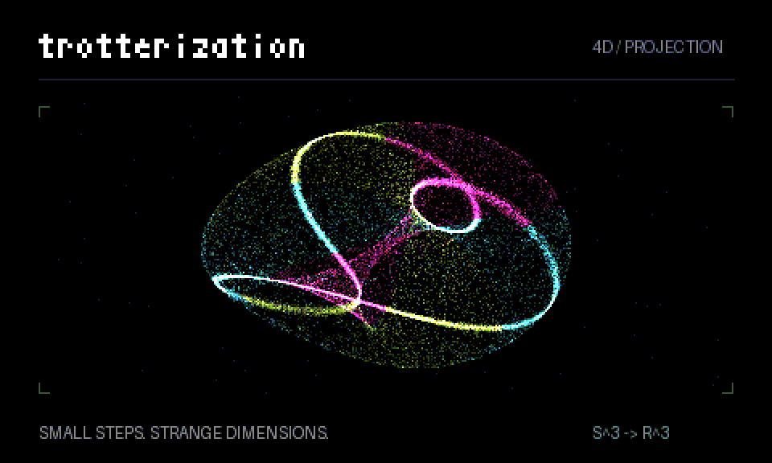

  

  <strong>Small steps. Strange dimensions.</strong> 
  A place for ideas to become experiments, and experiments to become useful things.

  <a href="https://github.com/trotterization?tab=repositories">explore the code</a>
  &nbsp; · &nbsp;
  <a href="https://github.com/trotterization/jibiji">jibiji 笔记</a>
  &nbsp; · &nbsp;
  <a href="https://github.com/pyrrhonic">@pyrrhonic</a>

---

$$
e^{A+B}=\lim_{n\to\infty}\left(e^{A/n}e^{B/n}\right)^n
$$

Build something complicated. One small step at a time.

**Currently taking shape → [Jibiji 笔记](https://github.com/trotterization/jibiji)**

A handwriting-first app for Mandarin learners. Write naturally, get suggestions in place, and turn your notes into flashcards.

The math behind the pixels

The animation starts with a Clifford torus in four dimensions:

$$
\frac{1}{\sqrt{2}}(\cos u,\sin u,\cos v,\sin v).
$$

It rotates in two 4D coordinate planes before a stereographic projection into 3D and a final projection onto your screen. A dense winding across the surface makes the luminous threads. Each frame is rendered at half resolution and enlarged with nearest-neighbor sampling, so every pixel stays sharp.

The eight-second loop is generated from [a small Python script](https://github.com/trotterization/.github/blob/main/scripts/render_banner.py).

