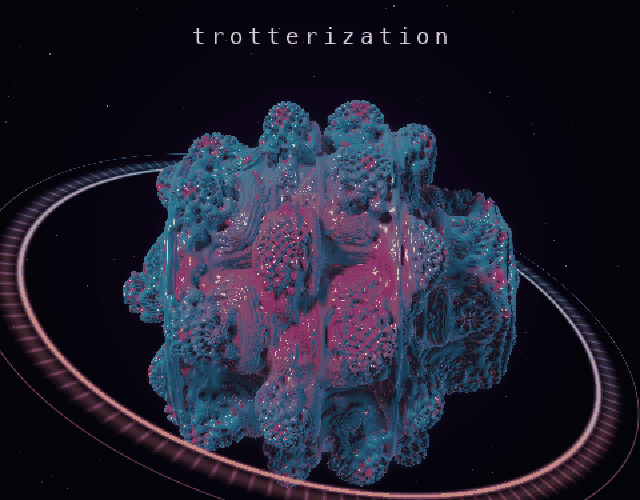

  

  <a href="https://github.com/trotterization/jibiji">jibiji 笔记</a>
  &nbsp; / &nbsp;
  <a href="https://github.com/orgs/trotterization/repositories">repositories</a>
  &nbsp; / &nbsp;
  <a href="https://github.com/pyrrhonic">pyrrhonic</a>

Behind the image

A changing three-dimensional slice through a four-dimensional fractal, built by repeatedly raising hyperspherical coordinates to a power and adding the starting point. The slice, exponent, and viewing angle change together through a seamless loop. Ray marching reveals its recursive folds; cyan and rose lighting catch the edges.

The image is rendered with a [Metal shader](https://github.com/trotterization/.github/blob/main/scripts/fractal.metal), then sampled into a shared GIF palette and enlarged with crisp pixels.

$$
e^{A+B}=\lim_{n\to\infty}\left(e^{A/n}e^{B/n}\right)^n
$$

